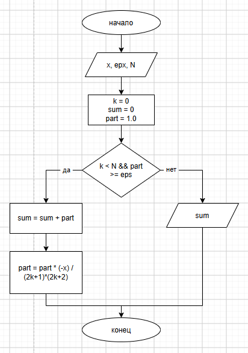

# Лабораторная работа №10
  
Студент: Полякова В.Д.
Группа: бТИИ-261

## Задание

Вычисление значений двух составных математических функций, а также их произведения, разности квадратов и удвоенной суммы.
Вычисление значения функции cos(x) с помощью разложения в ряд Маклорена (Тейлора) двумя способами: с заданным количеством членов ряда (N) и с заданной точностью (eps).

**Требуется:**
1. Составить блок-схему алгоритма решения.
2. Написать программу на языке C.

## Блок-схема

